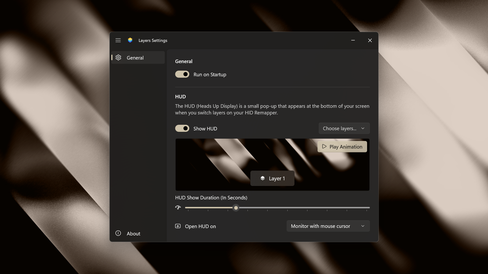

<div align="center">


# Layers

Windows 11 tray indicator for the active [HID Remapper](https://github.com/jfedor2/hid-remapper) layer.

<a href="https://apps.microsoft.com/detail/9N65CFXGLKXB?mode=direct">
    
</a>

</div>

The tray icon shows the layer you are on. Switch layers on your peripheral and it updates instantly, with an optional heads-up display at the bottom of the screen. Click the icon for status and settings.

Built with C# and WinUI 3 on the Windows App SDK, compiled with Native AOT. The runtime ships with it, so there's nothing else to install.

## Demo

https://github.com/user-attachments/assets/adcb7c98-7fc8-4c50-9145-f2db5c19f211

## Install

Get it from the [Microsoft Store](https://apps.microsoft.com/detail/9N65CFXGLKXB), or download `Layers-<version>.msi` from the [latest release](../../releases/latest) and run it. It installs per-user, so there's no UAC prompt. Prefer MSIX? Download `Layers-<version>.msix` instead. Plug in a flashed HID Remapper and it works — nothing to configure.

Uninstall from Settings → Apps.

## Settings



Click the tray icon and choose **Settings…**. Under **HUD**, turn **Show HUD** off entirely, or use **Choose layers...** to silence it for individual layers — a silenced layer stays silent in both directions, so a muted hold-to-activate layer will not announce the layer you land back on either. **Run on Startup** turns start at sign-in on or off.

Stored under `HKCU\Software\Layers`.

## Shortcut sheet

Left-click the tray icon, pick **Shortcuts** from its menu, or press **Win+Shift+L** from anywhere to see every shortcut on your HID Remapper. Each layer gets its own section, with the layer you're on marked **Active**. Inside a layer, every mapped key is one row: the key on the left, and everything it does on that layer on the right, so a key's tap and hold read together. Tap, hold and sticky mappings are tinted, macros spell out the keys they send, and mouse buttons, media keys, scrolling, layers and macros carry their own icons. The search box filters the list. Esc, clicking elsewhere, or pressing the hotkey again closes it.

The pencil in the footer opens the web config tool ([remapper.org/config](https://remapper.org/config) unless you change it) so you can edit your shortcuts. The sheet re-reads the device every time it opens, so your edits show up as soon as you save.

Under **Settings › Shortcuts** you can:

- Change or clear the hotkey.
- Change the web config tool's address.
- Say what each expression does. Expressions are hard to read on their own, so the sheet shows your description in their place. Put a key name in braces, like `Hold {Back} and swipe left`, or pick one with the key button, and it shows as a key.

## How it reads the layer

The firmware has no command for it, so on connect the app writes the expression `layer_state 0xFF000001 monitor` into a free expression slot and reads it back over Monitor mode.

**This touches device RAM only.** `PERSIST_CONFIG` is never sent, so nothing reaches flash and unplugging reverts the device. `CLEAR_EXPRESSIONS` is never sent, so your own expressions are untouched. `SUSPEND` is never sent, so a crash cannot leave your keyboard unresponsive.

Requires firmware config version 18. If all eight expression slots are in use, the tray shows connected but cannot read the layer.

The device is opened with shared access, so the [web config tool](https://www.jfedor.org/hid-remapper/) can connect while Layers is running, and Layers connects while the tool is open. The tool switches Monitor mode off when it connects and when you leave its Monitor tab; Layers switches it back on within about 4 seconds, and a layer switched during that gap shows once you switch again.

## Building

You'll need the [.NET SDK 10](https://dotnet.microsoft.com/download) and the Visual Studio C++ build tools (for the Native AOT link step). Then run:

```powershell
pwsh -File build.ps1
```

That builds `dist\Layers-<version>.msi` and `dist\Layers-<version>.msix`. Set `LAYERS_SIGN_CERT` (and `LAYERS_SIGN_PASSWORD` for a .pfx) to sign them. Otherwise they're built unsigned with a warning.

## Credits

Glyphs from [fluentui-system-icons](https://github.com/microsoft/fluentui-system-icons) (MIT) — see [`assets/NOTICE-fluentui.txt`](assets/NOTICE-fluentui.txt). The shortcut picker and key caps are from [PowerToys](https://github.com/microsoft/PowerToys) (MIT), and the key names come from the web config tool's `usages.js` — see [`assets/NOTICE-powertoys.txt`](assets/NOTICE-powertoys.txt). Built for [jfedor2/hid-remapper](https://github.com/jfedor2/hid-remapper).

[MIT](LICENSE).
